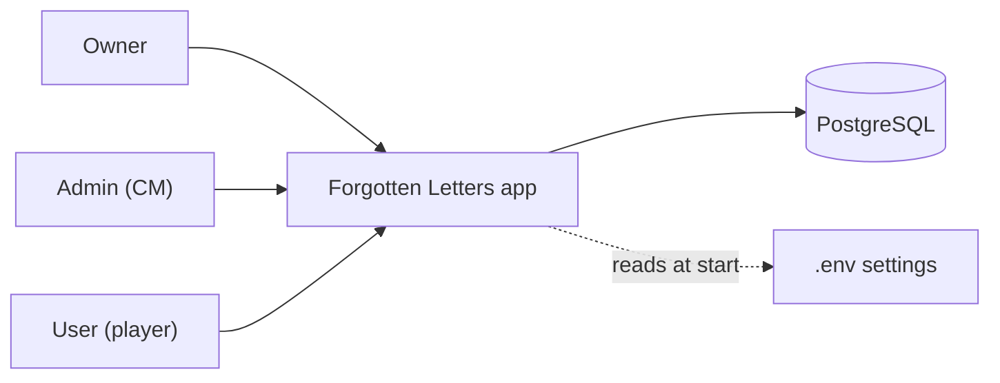
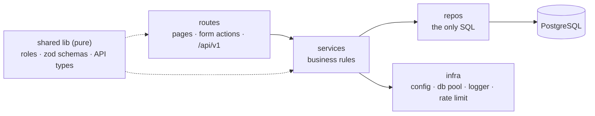

# Forgotten Letters — Architecture

Status: draft for review · Last updated: 2026-10-04

This document explains how the system is built and why. The detailed, always-current picture is the **atlas
model** in `architecture/` (LikeC4): every container, module, page, API endpoint, table and workflow, checked
against the code. Read `architecture/MAP.md` (generated) before reading code.

## 1. Constraints that shape everything

- **Self-hosted by gaming groups:** one app container and one database, installed with Docker Compose on a laptop
  or a server. No cloud services; works on a LAN without internet.
- **Simple before scalable:** no load balancer, replicas, Redis or queues. The code is layered so they could be
  added later without rewrites.
- **Newest stable versions** of the stack.
- **Copyrighted book content is never in the repository** (see PRODUCT.md §10).

## 2. System context



## 3. Containers (`compose.yaml`)

| Container | Image | Responsibility |
|---|---|---|
| `app` | our image, Node 26, SvelteKit 3 (`adapter-node`) | Serves pages, form actions, the JSON API and live updates. On start: checks settings, applies migrations, creates the first owner, then listens on 3000. Shuts down gracefully. |
| `db` | `postgres:18` | All data, on a named volume. Healthchecked; the app waits for it. |
| `caddy` *(optional profile `https`)* | `caddy:2` | HTTPS certificate for a server deployment. Off on a LAN. |

Development runs `db` from `compose.dev.yaml` and the app with `npm run dev`.

## 4. Inside the app: layers



| Layer | Folder | May use | Never |
|---|---|---|---|
| Routes | `app/src/routes/**` | services, shared lib | SQL, Drizzle |
| Services | `app/src/lib/server/services/` | repos, infra, shared lib | request/response objects |
| Repos | `app/src/lib/server/repos/` | Drizzle, the schema | business rules |
| Infra | `app/src/lib/server/infra/` | Node, drivers | app logic |
| Shared lib | `app/src/lib/` (no `server/`) | nothing server-side | I/O |

Dependencies point one way: routes → services → repos. Pages and the API call the **same services**, so they
behave the same.

## 5. Data

- **PostgreSQL 18**, accessed with **Drizzle ORM**; migrations generated by `drizzle-kit`, committed as SQL,
  applied by the app at start.
- **One Postgres schema per area:** `auth` (step 1); `campaign`, `rules`, `warband`, `map` as they arrive.
- **Ids:** `uuid` from Postgres 18's built-in `uuidv7()` (time-ordered). Append-only logs use `bigint identity`.
- **Constraints in the database:** foreign keys, uniques, checks; `timestamptz` everywhere; `updated_at` kept by
  a trigger.
- **Lists are paged by key** (`?after=<id>&limit=<n>`, `n` ≤ 100), never by offset.
- **Housekeeping** (expired sessions and invites) runs hourly inside the app.

Step 1 tables (`auth` schema): `users`, `sessions`, `invites`, `audit_log` — columns and indexes in the atlas model
and the migration.

## 6. Cross-cutting concerns

**Authentication.** Own sessions, no auth library: scrypt password hashes (`node:crypto`); a random session token
in an httpOnly, SameSite=Lax cookie, only its SHA-256 hash stored; 30-day sliding expiry; browser-session cookie
when "Remember me" is off. Sign-in is rate limited in memory (5 a minute per username and per address) and
answers the same for a wrong password and an unknown name.

**Authorisation.** Roles owner (3) > admin (2) > user (1). One function, `can(user, role)`, guards route groups
(`(owner)`, `(admin)`, `(user)`), form actions and API handlers. Services re-check what they change (for example,
never removing the last owner).

**Input and errors.** Every input is parsed with **zod**. Services throw `AppError(code, status, message)`; one
handler turns it into the API's error shape `{ "error": { "code", "message", "requestId" } }`, or a form error on
pages. Unexpected errors are logged and answered as `internal` without details.

**Observability.** **pino** JSON logs; every request gets an id (`X-Request-Id` header, in every log line and
error). `GET /health` reports the app and the database.

**Configuration.** `.env`, parsed with zod at start; the app refuses to start and names the bad setting.
`.env.example` documents every variable.

**Resilience.** The database pool connects with retry and backoff; every query has a timeout; invite redemption
runs in one transaction with a row lock; on SIGTERM the app finishes open requests and closes the pool.

**Live updates (step 5).** Server-Sent Events from the app; the map is drawn with PixiJS on a canvas.

## 7. API conventions

- JSON under `/api/v1/`, using the same session cookie as the pages. Versioned by path.
- Nouns and HTTP verbs: `GET /users`, `PATCH /users/:id`, `POST /invites`, `POST /invites/:token/accept`.
- Status codes: 200/201 success, 400 invalid input, 401 not signed in, 403 not allowed, 404 not found, 409
  conflict, 429 too many tries, 500 internal.
- **Every handler and form action starts with a doc comment**, which atlas reads into the model:

```ts
/**
 * Accept an invite and create the account.
 * Who: anyone holding the invite link.
 * In: { username, password, displayName? }
 * Out: 201 { user } and a session cookie.
 * Errors: 400 invalid, 404 unknown invite, 409 used or expired, 429 too many tries.
 */
export const POST: RequestHandler = async (event) => { … };
```

## 8. Workflows

Each workflow is a dynamic view in `architecture/features/`, walking routes → services → repos → tables with its
decisions. Step 1: first start, sign-in, invite and join, managing people, sessions, failure and recovery.

## 9. Repository layout

```
app/                 SvelteKit app (src/, drizzle/, e2e/, Dockerfile)
architecture/        atlas model: spec, model, views, features; generated/ and MAP.md are written by atlas
assets/              blender/ (scenes, seals), fx/ (rendered sprites), map/ (local only)
docs/                books and rule packs (local only), superpowers/ specs
tools/atlas/         the architecture tool;  tools/blender-mcp/  the Blender bridge (local only)
compose.yaml         app + db (+ optional caddy);  compose.dev.yaml  db only
```

## 10. Decisions

| # | Decision | Why | Date |
|---|---|---|---|
| 1 | SvelteKit + PostgreSQL in Docker Compose | One TypeScript app for pages, server and API; groups install with one command | 2026-10-03 |
| 2 | One app, one database; no Redis, load balancer or replicas | Built for single groups self-hosting; simpler to install and run | 2026-10-03 |
| 3 | Own sessions instead of an auth library | Small, well understood, no dependency to keep up | 2026-10-03 |
| 4 | Roles owner > admin > user, invites only | Matches how groups run; no email needed | 2026-10-03 |
| 5 | Newest stable versions (Postgres 18, Node 26, SvelteKit 3) | Use current features (`uuidv7()`), long support | 2026-10-03 |
| 6 | Atlas documents every workflow, endpoint and table | The model stays the map for people and agents | 2026-10-03 |

New decisions are added here with their date; a reversed decision is struck through, not deleted.
