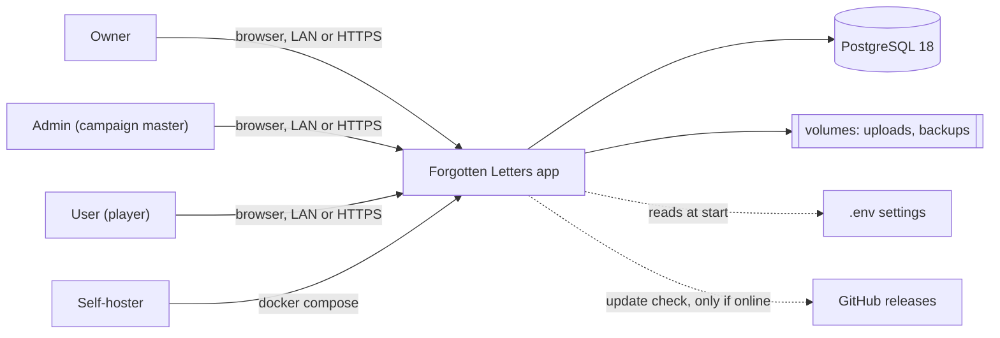
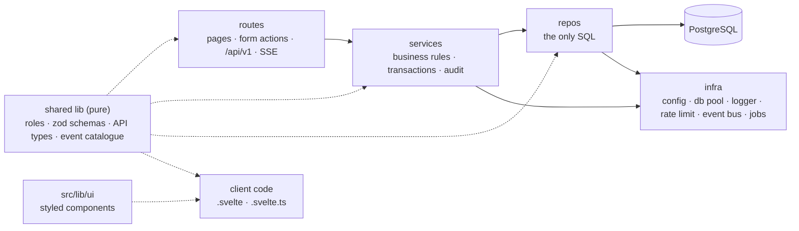
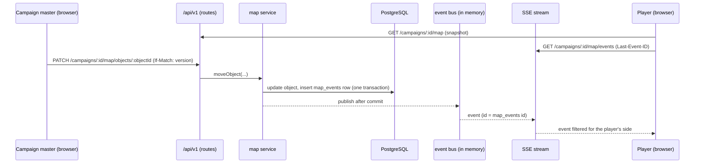

# Forgotten Letters: Architecture

Status: confirmed choices, ready for step 1 · Last updated: 2026-10-21

This document explains how the system is built and why. The detailed, always-current picture is the **atlas
model** in `architecture/` (LikeC4): every container, module, page, API endpoint, table, live event and workflow,
checked against the code. Read `architecture/MAP.md` (generated) before reading code.

Forgotten Letters is a self-hosted campaign companion for Trench Crusade, built first for the Carcass Front. It is
an unofficial fan project and is not affiliated with Factory Fortress.

## Contents

1. Constraints
2. Stack and versions
3. System context
4. Containers
5. Inside the app: layers
6. Request lifecycle
7. Data conventions
8. Migrations and rules editions
9. Authentication and authorisation
10. Validation
11. Errors
12. Logging, health, shutdown and background jobs
13. File storage
14. Live map
15. API conventions
16. Testing
17. Packaging, deploy, updates and backups
18. Configuration and secrets
19. Documentation with atlas
20. CI and releases
21. Repository layout
22. Decisions

## 1. Constraints

- **Self-hosted by gaming groups.** Each group runs its own copy with Docker Compose on a laptop, a home server or
  a small VPS. One app container and one PostgreSQL container. Caddy is an optional third container for internet
  servers.
- **Works offline.** The app runs fully on a LAN without internet. Fonts and icons are self-hosted in the image.
  There is no CDN and no outbound call, except an update check that runs only when the server is online.
- **Simple before scalable.** No Redis, load balancer, replicas, queues or other services. Seams (event bus,
  rate limiter, job lock) are drawn so a second process could be added later without rewriting routes or services.
- **Newest stable versions** of every tool, checked against the registry when added or upgraded.
- **Desktop first.** Design and verify at 1366 to 1920 px. Phone and TV layouts come later and are revisited
  before battles and results (step 6).
- **Copyright.** Book text, the campaign map, lore and rule packs belong to each group. They are never committed
  or shipped. `docs/*` (except `docs/superpowers/` and `docs/adr/`), `assets/map/` and `backups/` are git-ignored.

## 2. Stack and versions

Versions are the newest stable releases on 2026-10-21. Renovate keeps them current (§20).

| Area | Choice | Version | Why |
|---|---|---|---|
| Runtime | Node.js | 26 (`node:26-slim`) | Newest line, LTS from October 2026. Native fetch, WebStreams, type stripping. |
| Language | TypeScript, strict | 7.0 (native compiler) | One language for client, server and shared schemas. The Go compiler makes type checks fast. |
| Strictness | `noUncheckedIndexedAccess`, `verbatimModuleSyntax` | | Catches crashes on empty lists and missing rule-pack entries. Type-only imports use `import type`. |
| Package manager | npm, `package-lock.json` committed | 11 | Ships with Node. Renovate understands its lockfile. |
| Framework | SvelteKit | 3.0 | Pages, form actions, JSON API and SSE in one process. File routes that atlas can read. |
| UI library | Svelte (runes) | 5.57 | Fine-grained reactivity, small bundles. `$state` classes for the warband builder and map scene. |
| Build tool | Vite | 8.3 | Used by SvelteKit and Vitest with one config. |
| Server adapter | `@sveltejs/adapter-node` | 6.0 | Plain Node server, configured at runtime (`ORIGIN`, `BODY_SIZE_LIMIT`, `SHUTDOWN_TIMEOUT`). |
| UI primitives | Bits UI, wrapped in `src/lib/ui` | 2.19 | Accessible dialogs, menus, comboboxes and focus traps without a visual style to fight. |
| Styling | Plain CSS, tokens as custom properties, Svelte scoped styles | | One `tokens.css`. Modern CSS (nesting, container queries, `:has`, `color-mix`). |
| Icons | Own SVG sprite for game marks + `@lucide/svelte` for UI actions | 1.52 | Inline SVG, inherits `currentColor`, tree-shaken per icon. |
| Validation | zod | 4.6 | Schemas give types, field messages and JSON Schema for OpenAPI. |
| Database | PostgreSQL (`postgres:18`) | 18 | Schemas per area, native `uuidv7()`, row locks, LISTEN/NOTIFY, check constraints, async I/O. |
| Query layer | Drizzle ORM + drizzle-kit | 0.45 + 0.31 | Schema in TypeScript, generated SQL migrations, atlas already reads Drizzle tables. |
| Database driver | postgres.js | 3.4 | Fast, dependency free, pooling, statement timeouts, `listen()` with reconnect. |
| Images | sharp | 0.35 | Thumbnails, WebP conversion, pixel caps for uploads. |
| Map renderer | PixiJS + pixi-viewport | 8.22 + 6.0 | WebGPU with WebGL fallback, sprites, particle containers, render textures. Pan, zoom and clamping. |
| OpenAPI | zod-openapi | 6 | OpenAPI 3.1 built from the zod schemas each endpoint exports. |
| Logging | pino + pino-pretty (dev) | 10.4 + 13.2 | Fast JSON to stdout, child loggers, redaction. |
| Lint and format | ESLint (flat config) + typescript-eslint + eslint-plugin-svelte; Prettier + prettier-plugin-svelte | 10 + 3.9 | Standard pair. Layer import rules live in the ESLint config. |
| Unit tests | Vitest (v8 coverage) | 5.0 | Same config and aliases as the app. |
| Database in tests | `@testcontainers/postgresql` with `postgres:18` | 12.2 | Real Postgres catches constraint, transaction and lock bugs that mocks hide. |
| Browser tests | Playwright | 1.63 | Chromium and Firefox, traces, several browser contexts in one test. |
| Architecture model | LikeC4, generated and checked by `tools/atlas` | 1.59 | Interactive diagrams that cannot drift from the code. |
| HTTPS (optional) | Caddy (`caddy:2`, profile `https`) | 2 | Automatic Let's Encrypt or internal certificates. |
| CI | GitHub Actions, Renovate, Gitleaks | | Checks on every pull request, multi-arch releases to GHCR. |

Not used, on purpose: Redis, an auth library (Better Auth, Auth.js), a component kit with its own look, Tailwind,
a metrics stack, an external error tracker.

## 3. System context



Visitors who are not signed in see only the sign-in, setup and invite pages.

## 4. Containers (`compose.yaml`)

| Container | Image | Volumes | Healthcheck | Responsibility |
|---|---|---|---|---|
| `app` | `ghcr.io/<org>/forgotten-letters:<major>`, built from `node:26-slim` | `uploads` at `/data/uploads`, `backups` at `/data/backups` (or `BACKUP_DIR`) | `GET /health/live` | Serves pages, form actions, `/api/v1`, SSE. On start: parse config, wait for the database, dump and migrate, print the setup link if no owner exists, start jobs, listen on 3000. |
| `db` | `postgres:18` | `pgdata` | `pg_isready` | All data. Not published to the host network. |
| `caddy` (profile `https`) | `caddy:2` | `caddy_data`, `caddy_config` | | TLS for `DOMAIN`, proxies to `app:3000`. Off by default on a LAN. |

Compose settings for every service: `restart: unless-stopped`, `init: true`. The app has
`depends_on: db: condition: service_healthy` and `stop_grace_period: 30s`.

**App image.** Multi-stage build. The build stage runs `npm ci` and `npm run build`. The runtime stage copies the
build output, production dependencies and the PostgreSQL 18 client tools (for `pg_dump`). It runs as the `node`
user, uses a read-only root filesystem where possible (writable: the two volumes and `/tmp`), and has a
`HEALTHCHECK` on `/health/live`.

Development runs `db` from `compose.dev.yaml` and the app with `npm --prefix app run dev`.

## 5. Inside the app: layers



| Layer | Folder | May import | Never |
|---|---|---|---|
| Routes | `app/src/routes/**` (`+page.svelte`, `+page.server.ts`, `+layout.server.ts`, `+server.ts`) | services, shared lib, `$lib/server/http` helpers, `src/lib/ui` | repos, Drizzle, SQL, infra internals |
| Services | `app/src/lib/server/services/<area>.ts` | repos, infra, shared lib | `RequestEvent`, `Request`, `Response`, cookies, HTTP status helpers |
| Repos | `app/src/lib/server/repos/<area>.ts` | Drizzle, `app/src/lib/server/db/schema/`, infra (db pool) | services, business rules, zod request schemas |
| Database schema | `app/src/lib/server/db/schema/<area>.ts` | Drizzle | anything else |
| Infra | `app/src/lib/server/infra/` | Node built-ins, drivers, shared lib | services, repos, routes |
| Shared lib (pure) | `app/src/lib/` except `server/` (`schemas/`, `roles.ts`, `api/`, `events/`) | other shared lib files, zod | `$lib/server/**`, I/O, globals |
| UI components | `app/src/lib/ui/` | shared lib, Bits UI, Lucide | `$lib/server/**` |

Rules that hold everywhere:

- Dependencies point one way: routes → services → repos. Pages and the API call the **same services**, so they
  behave the same.
- Route files stay thin: parse input, call one service, shape the response.
- One file per area in each layer: `services/campaigns.ts`, `repos/campaigns.ts`, `schemas/campaigns.ts`.
- Services open transactions with `db.transaction` and pass `tx` to repos. Every repo function takes a db-or-tx
  argument. An `afterCommit(fn)` helper runs work (live events) only once the transaction commits.
- Client state uses Svelte 5 runes in `.svelte.ts` modules, shared through context per page. No state library.

**How it is enforced.** ESLint flat config lists the allowed imports per folder with `no-restricted-imports`
(switch to `eslint-plugin-boundaries` 7 if the rule list grows hard to read). A wrong import fails lint in the
editor and in CI. SvelteKit itself refuses to bundle `$lib/server` into client code. Atlas draws import edges, so a
violation is also visible in the diagrams.

## 6. Request lifecycle

`app/src/hooks.server.ts` runs these steps in order with `sequence()`:

1. **Request id.** Take `X-Request-Id` from the client if it is at most 64 characters of `[A-Za-z0-9._-]`;
   otherwise create a uuidv7. Store it in `event.locals.requestId`.
2. **Readiness gate.** While the app is starting or shutting down, `/api/v1/**` and pages answer 503 (code `unavailable`) with the
   standard error shape. `/health/*` always answers.
3. **Session.** Read the session cookie, hash it with SHA-256, look up the session, extend its expiry when more than
   a day has passed (sliding 30 days), set `event.locals.user` and `event.locals.session`. A disabled user's session
   is ignored and deleted.
4. **API guard** (only `/api/v1/**`). Writes must send `Content-Type: application/json` (uploads excepted) and an
   `Origin` that matches `ORIGIN`. Otherwise 400 or 403.
5. **Resolve** the route, with a request deadline (§15).
6. **Log** one line: method, route id, status, duration in ms, request id, user id.
7. **Respond** with `X-Request-Id` on every response.

`handleError` in the same file logs unexpected errors with their stack, stores them in the error log (§12), and
returns `internal` with the request id and no details. `AppError` is mapped in one place for each surface: the API
wrapper (§15) for `+server.ts`, and the form helper for form actions.

## 7. Data conventions

| Rule | Detail |
|---|---|
| Schemas per area | One Postgres schema per area: `auth` (step 1), then `campaign`, `rules`, `warband`, `map`, `battle`. Drizzle `pgSchema`. Tables are named `auth.users`, `map.objects`. `search_path` stays at `public`. |
| Cross-area keys | Foreign keys between areas point downward only (`warband` → `rules`, `campaign` → `auth`). |
| Primary keys | `uuid` with database default `uuidv7()` for entities. `bigint generated always as identity` for append-only logs (`audit_log`, `map_events`). Ids never come from the client. |
| Standard columns | `created_at` and `updated_at` `timestamptz not null default now()` on every table. One shared trigger keeps `updated_at` current. Times are stored in UTC and shown in the viewer's time zone. |
| Optimistic locking | Editable rows (campaigns, warbands, maps, map objects) carry `version integer not null default 1`, increased on each update. A stale version gives 409 `conflict`. Read-only and log tables skip it. |
| Naming | `snake_case` in SQL, `camelCase` in TypeScript, mapped by Drizzle's `casing` option. |
| Constraints in the database | Foreign keys, uniques, `not null`, check constraints or Postgres enums for allowed values and ranges. A `psql` edit cannot store a role of 7 or negative points. |
| Paging | Key paging only: `?after=<id>&limit=<n>`, `n` from 1 to 100, default 50. Other sort orders use a compound cursor (value and id). Never `OFFSET`. |
| Deleting | Soft delete only for campaigns and warbands (`deleted_at timestamptz`, partial unique indexes so names stay usable). Restorable from the admin area for 30 days, then purged by a job. Everything else is a hard delete. Accounts are disabled, never deleted. |
| Audit log | `auth.audit_log`, append-only. Row per important action: actor, action, target type and id, before/after summary `jsonb`, request id, time. Written by services in the same transaction as the change. Owners browse it with filters. |
| JSONB | Only for typed, zod-validated props (for example map object props per kind). Never for data that needs joins or constraints. |

Step 1 tables (`auth` schema): `users`, `sessions`, `invites`, `setup_tokens`, `audit_log`. Columns and indexes are
in the atlas model and the migration.

## 8. Migrations and rules editions

**Writing a migration.** Change the TypeScript schema, run `npm --prefix app run db:generate` (drizzle-kit
generate), review and edit the SQL file, commit it in `app/drizzle/`. Triggers and functions are hand-written SQL
appended to the generated file. `drizzle-kit check` runs in CI to catch drift between schema and migrations.

**Applying migrations.** At start, before listening, the app:

1. takes a Postgres advisory lock, so two starting copies never migrate at once;
2. if migrations are pending, writes a `pg_dump` to the backups volume;
3. applies the pending migrations, each in a transaction, logging name and duration;
4. releases the lock and starts. If a migration fails, the app logs the error and exits with a non-zero code; the
   database stays at the last good migration and the dump is the undo.

**Forward-only.** No down files. A fix ships as a new migration. Pre-migration dumps are pruned with the daily
backups (§17).

**Breaking changes: expand then contract.** Add the new column, write both, migrate the data, remove the old
column in a later release. Each step is its own migration and the code supports both shapes in between. The plan
is written in the migration file header. Release notes flag migrations that take long.

**Rules editions.** Rules data is game content, so it never ships in migrations.

- `rules.editions` lists editions. Units, items, keywords and limits reference `edition_id`.
- Campaigns pin an edition; warbands store the edition they were built for. Each campaign shows its edition.
- Owners upload a rule pack (or point at a local file). The pack is versioned JSON validated by zod. The importer
  validates the **whole** pack first and reports every problem with its path in the file. Only a valid pack is
  imported, upserted into the chosen edition in one transaction. The result is written to the audit log.

## 9. Authentication and authorisation

**Accounts.** Username and password. New accounts only through invite links (7 days, single use). No email, no
OAuth. Users cannot invite.

**First owner.** On start, if no owner exists, the app creates a one-time setup token and prints the setup URL
(`<ORIGIN>/setup/<token>`) in the logs (`docker compose logs app`). Visiting it lets the person choose a username and
password and become the owner. The token is stored hashed and expires after use or after one hour; a restart
prints a fresh link while there is still no owner.

**Passwords.** scrypt from `node:crypto`: N=2^17, r=8, p=1, random 16-byte salt, `timingSafeEqual` compare. Stored
as a versioned string (`scrypt$v1$...`) so parameters can be raised later and the hash upgraded on the next sign-in.

**Sessions.** Own implementation following the Lucia v3 guide and OWASP session advice, no auth library.

- A random 32-byte token in an `httpOnly`, `SameSite=Lax` cookie, `Secure` on HTTPS. Only its SHA-256 is stored.
- Session row: user, token hash, expiry, user agent, last seen. 30-day sliding expiry. "Remember me" off gives a
  browser-session cookie.
- Users see their devices and can sign out other devices from their profile. Revoking deletes the row.
- Disabling an account ends all its sessions. Expired sessions and invites are removed hourly.

**Sign-in protection.** In-memory sliding-window limiter (`infra/rate-limit.ts`): 5 tries a minute per username
and, separately, per IP, so one person cannot lock out a whole venue. The same limiter guards invite redemption and
setup. Wrong password and unknown username get the same message. Failures are logged for owners. The limiter has a
small fixed interface so it could move to Postgres later.

**Cross-site requests.** SvelteKit's `csrf.checkOrigin` blocks foreign form posts with 403. `SameSite=Lax` stops
the cookie on cross-site writes. The API also requires `application/json` and a matching `Origin` (§6).

**Roles.** Site roles rank owner (3) > admin (2) > user (1). `can(user, role)` in `src/lib/roles.ts` is the only
check. Route groups `(owner)`, `(admin)`, `(user)` guard pages in their layout load; form actions and API handlers
check again, because layouts do not guard actions. Services re-check what they change. Admins can play.

| Owner action | Rule |
|---|---|
| Invite admins and users | Invite carries the role. |
| Change roles | Never remove the last owner (checked in the service, inside a transaction with a row lock). |
| Disable an account | Ends its sessions. No permanent delete. |
| Reset a password | Sets a temporary password that must be changed at the next sign-in. |

**Campaign membership (step 2).** A membership table gives campaign rights (campaign master, co-campaign master,
player). Services check membership for campaign data.

## 10. Validation

Everything that crosses a trust boundary is parsed with **zod 4.6** before code touches it.

| Input | Where it is parsed | On failure |
|---|---|---|
| Form posts | Form helper `parseForm(schema, formData)` in the action | `fail(400, { values, errors })` in one shape; a small component shows field errors. |
| JSON bodies, path params, query strings | API wrapper, which requires a schema per handler | 400 `invalid` with `fields`. |
| Environment variables | `infra/config.ts` at start | App exits naming the variable, never printing a secret value. |
| Rule-pack files | Importer, whole file first | Every problem listed with its path; nothing imported. |
| Live map edits | Same API wrapper as other writes | 400 `invalid`. |
| Map object props | Per-kind schema before the repo writes `jsonb` | 400 `invalid`. |
| API responses | Vitest API tests only, never in production | Test fails. |

Schemas live in `app/src/lib/schemas/<area>.ts` and are shared by routes, services and client code. Routes parse;
services trust the parsed types. Server-only refinements (uniqueness, membership) happen in services. Client code
can reuse the same schemas for early checks later.

## 11. Errors

Services throw `AppError(code, status, message, fields?)`. Services never build HTTP responses; routes never build
error JSON by hand.

API error shape:

```json
{ "error": { "code": "invalid", "message": "Check the highlighted fields.", "requestId": "0192…", "fields": { "username": "Too short" } } }
```

| Code | Status | Meaning |
|---|---|---|
| `invalid` | 400 | Input failed its schema or a business rule; `fields` holds per-field messages. |
| `unauthenticated` | 401 | Not signed in, or the session expired. |
| `forbidden` | 403 | Signed in but not allowed, or a cross-site request. |
| `not_found` | 404 | No such resource, or the caller may not know it exists. |
| `conflict` | 409 | Stale `version`, a used or expired invite, a duplicate name, the last owner. |
| `rate_limited` | 429 | Too many tries; `Retry-After` header set. |
| `unavailable` | 503 | Starting, shutting down or past the request deadline; `Retry-After` header set. |
| `internal` | 500 | Unexpected error; logged with stack, no details returned. |

The list is fixed. A new code needs a decision row (§22). Pages show the same message and the request id, so a
self-hoster can quote it in an issue.

## 12. Logging, health, shutdown and background jobs

**Logging.** pino 10 writes JSON to stdout (`docker compose logs app`); pino-pretty in development. `LOG_LEVEL` sets
the level. Child loggers carry `requestId`, `userId` and route. Redaction hides passwords, tokens, cookies and
secret config keys. One line per request, plus warnings and errors.

**Error log.** Unexpected errors are also kept in a small capped table beside the audit log. Owners see recent
errors in the owner area and can copy one into an issue.

**Metrics and tracing.** None. Request duration in the access log is enough for one group. A metrics module can be
added later behind an env flag without changing services.

**Health.**

| Endpoint | Checks | Answers | Used by |
|---|---|---|---|
| `GET /health/live` | Process up, event loop responsive. No database call. | 200 | Docker healthcheck; Docker restarts the container after repeated failures. |
| `GET /health/ready` | Database reachable (short query) and all migrations applied. | 200, or 503 while starting or after SIGTERM | Caddy, the CI smoke test, people. |

`/health/ready` adds image tag, git commit and schema version only for a signed-in owner; others get the status
alone, so strangers cannot read version numbers.

**Server entry.** A small custom server file (`app/server/index.js`) imports adapter-node's `build/handler.js`,
owns the HTTP server, starts the jobs and the SSE hub, and handles shutdown.

**Graceful shutdown on SIGTERM.**

1. Readiness turns 503.
2. SSE streams get a final `retry` hint and close; clients reconnect to the next start.
3. Background jobs stop taking new runs.
4. Open requests finish within `SHUTDOWN_TIMEOUT` (default 20 s, inside compose's 30 s grace period).
5. The pool and the LISTEN connection close; the process exits 0.

**Background jobs.** An in-process timer (`infra/jobs.ts`) runs housekeeping. Each run takes
`pg_try_advisory_lock` for its job, so only one process runs it even if a second ever exists. Each run logs start,
end and counts. A failed run is logged and tried again on the next tick.

| Job | Interval |
|---|---|
| Remove expired sessions, invites and setup tokens | Hourly |
| Purge soft-deleted campaigns and warbands older than 30 days | Daily |
| Daily backup and pruning to 14 days | Daily |
| Prune old `map_events` outside the replay window (step 5) | Hourly |
| Update check (only when online) | Daily |

**Database pool.** postgres.js pool, max 10 connections, plus one dedicated connection for LISTEN. Pool start waits
for the database with retry and backoff. `statement_timeout` is 5 s on normal connections and longer for imports
and backups.

## 13. File storage

- Uploads (map images, faction art) go to the `uploads` volume at `/data/uploads`, named by a uuid.
- A table stores owner, kind, size, content type, SHA-256 hash and dimensions.
- The app serves files itself, checking the caller's rights first. No public static folder for uploads.
- Upload routes stream the body with their own size limit, so a large file never fills memory. Type is checked from
  the file content, not the name. Pixel size is capped.
- sharp converts images to WebP and makes thumbnails.

## 14. Live map (step 5)

The live map shows positions, effects and fog to every viewer of a campaign. One or two campaign masters edit; many
players watch. Tens of viewers per group, which one Node process handles easily.



**Transport.** Server-Sent Events from `GET /api/v1/campaigns/:id/map/events` (`text/event-stream`), streamed
from a `+server.ts`. Every event has an `id` (the `map_events` bigint id). A heartbeat comment every 20 s keeps
proxies open; the `retry` field sets reconnect delay. Edits go up as normal `POST`/`PATCH` requests, reusing auth,
validation and the error shape.

**Event bus.** `infra/event-bus.ts`, a small publish/subscribe module keyed by campaign. Services publish only after
commit (`afterCommit`). Every event carries the campaign id, map version and event id. The module has a fixed
interface so a Postgres LISTEN/NOTIFY version can replace it if a second process ever exists.

**State and replay.**

- The server is the authority. It stores the map (`map.maps`: image, size, grid) and its objects (`map.objects`:
  kind, position in map units, layer, z, `version`, props `jsonb` validated per kind).
- Every change also appends a row to `map.map_events`.
- A client loads a snapshot, then applies events in order. Version numbers detect gaps.
- On reconnect the browser sends `Last-Event-ID`. The server replays later events from `map_events`; if the id is
  older than the replay window, it sends a `resync` event and the client reloads the snapshot.
- A stale `version` on an edit gives 409.

**Fog of war.** The server decides what each side may see. Hidden units are never sent to players who should not
see them, neither in the snapshot nor in events. The client draws fog with a render-texture mask.

**Event catalogue.** Every live event type is declared once in `app/src/lib/events/` (plain TypeScript with a zod
payload schema and its audience). Atlas documents it from there.

**Rendering.** PixiJS 8.22 on a canvas, pixi-viewport 6 for pan, zoom and clamping. The scene model is a
`.svelte.ts` class with `$state` fields. Panels, context menus and tooltips are normal Svelte components positioned
over the canvas with scene-to-screen coordinates, so every action is reachable by keyboard through the panels.

**Asset pipeline.**

- Effects (explosions, smoke, muzzle flashes, blessings) are rendered in Blender from `assets/blender/` into
  `assets/fx/`.
- A build script packs them into texture atlases with JSON frame data, played as `AnimatedSprite`.
- Atlases are served with hashed file names and long cache headers.
- User map uploads go through sharp (WebP, thumbnails, pixel cap) (§13).

## 15. API conventions

- **REST-style JSON under `/api/v1/`**, versioned by path, using the same session cookie as the pages.
- **Nouns and HTTP verbs:** `GET /users`, `PATCH /users/:id`, `POST /invites`, `POST /invites/:token/accept`.
- **One wrapper** (`$lib/server/http/api.ts`) for every `+server.ts` handler: parses params, query and body with the
  handler's zod schemas, checks the role, maps `AppError` to the error shape, sets `X-Request-Id`.
- **Paging:** `?after=<id>&limit=<n>` (n ≤ 100). Responses are `{ items, next }`; `next` is the cursor for the next
  page or `null` at the end.
- **Optimistic locking:** editable resources return `version` in the body and an `ETag`. Updates send `If-Match`
  or a `version` field. A stale version gives 409 `conflict`, so two admins never silently overwrite each other.
- **Status codes:**

| Status | When |
|---|---|
| 200 | Read or update succeeded. |
| 201 | Created; body holds the new resource. |
| 204 | Deleted or action with no body. |
| 400 | `invalid` input. |
| 401 | `unauthenticated`. |
| 403 | `forbidden`. |
| 404 | `not_found`. |
| 409 | `conflict`. |
| 413 | Body too large. |
| 429 | `rate_limited`. |
| 500 | `internal`. |
| 503 | Starting, shutting down or the request deadline passed (code `unavailable`, with `Retry-After`). |

- **Limits:** `BODY_SIZE_LIMIT` caps bodies at 1 MB; upload routes stream with their own limit. Queries time out
  after 5 s (`statement_timeout`); a request deadline aborts long handlers with 503.
- **OpenAPI:** each endpoint exports its schemas; a script uses zod-openapi 6 to build OpenAPI 3.1, served at
  `/api/v1/openapi.json`, with a Scalar reference page for admins. Generated in CI and checked into the atlas output.

**Every API handler and form action starts with a doc comment.** Atlas reads it into the model; lint fails when
one is missing or malformed. The lines are: what it does (first line), `Who:`, `In:`, `Out:`, `Errors:`.

```ts
/**
 * Accept an invite and create the account.
 * Who: anyone holding the invite link.
 * In: { username, password, displayName? }
 * Out: 201 { user } and a session cookie.
 * Errors: 400 invalid, 404 not_found unknown invite, 409 conflict used or expired, 429 rate_limited.
 */
export const POST: RequestHandler = api({ body: acceptInviteSchema }, async ({ body, event }) => { … });
```

API tests keep the comments honest: each documented status has a test.

## 16. Testing

A pyramid: many fast unit tests, service tests on a real database, API tests for every endpoint, a few browser
journeys, and an upgrade test.

| Kind | Tool | Covers | Rule |
|---|---|---|---|
| Unit | Vitest 5 (project `unit`) | Pure rules: roles, points, limits, schemas, rule-pack parsing | Required for every rule function. |
| Component | Vitest 5 (project `component`) | `src/lib/ui` wrappers and tricky Svelte components | Where behaviour matters. |
| Service | Vitest 5 (project `server`) + Testcontainers `postgres:18` | Transactions, constraints, row locks (two people redeeming one invite at once) | One Postgres container per run, migrations applied in global setup; each test runs in a transaction rolled back at the end. |
| API | Vitest 5 + real handlers + test database | Status codes, error shape, auth and role checks, response schema | Every endpoint. Atlas lists untested endpoints. |
| End-to-end | Playwright 1.63 against the production build | First start (setup link), sign-in, invite and join, managing people, building a warband, two viewers on the live map | Chromium on every pull request, Firefox nightly. |
| Migration | CI script | Apply all migrations to an empty database and to the previous release's fixture dump, then smoke test | Fixtures hold fake data only. |

Coverage (v8) is reported in CI and pull request summaries with no hard threshold; reviewers check that every
endpoint has an API test. Tests never use book content.

## 17. Packaging, deploy, updates and backups

**Install.** Download `compose.yaml` and `.env.example`, copy it to `.env`, set `ORIGIN` and the database password,
run `docker compose up -d`, open the setup link from `docker compose logs app`. Works on Docker Desktop and plain
Docker Engine.

**HTTPS.** `docker compose --profile https up -d` with `DOMAIN` set. Caddy gets a Let's Encrypt certificate, or uses
internal certificates for LAN names.

**Platforms.**

| Platform | Typical machines | Build and test |
|---|---|---|
| `linux/amd64` | Intel and AMD laptops, desktops, almost every VPS | Built natively, full test suite, E2E job. |
| `linux/arm64` | Raspberry Pi 4 and 5, Apple Silicon with Docker Desktop, ARM VPS | Built on native arm64 runners, smoke tested. |

**Updates.** `compose.yaml` pins a major tag (for example `:1`). Updating is `docker compose pull && docker compose
up -d`; the app dumps, migrates and starts (§8). The owner area shows when a newer version exists, only when the
server is online. Release notes per version flag long migrations and breaking changes.

**Backups.**

- A daily in-app job runs `pg_dump` (compressed) and archives the uploads into the `backups` volume. 14 days are
  kept.
- `BACKUP_DIR` can point the backups volume at a USB drive or NAS mount.
- Owners download a backup from the owner area.
- The restore command is documented in the README and tested by the migration test.

## 18. Configuration and secrets

- `.env` next to `compose.yaml`, read by Compose. `infra/config.ts` parses it with zod at start into a typed,
  frozen object. Nothing else reads `process.env`. A missing or malformed value stops the app with a message naming
  the variable. Unknown variables give a warning.
- `.env.example` documents every variable with its default. Defaults cover a LAN install.
- **Secrets** can be given directly or as a file path with the `_FILE` suffix (for example
  `POSTGRES_PASSWORD_FILE`), which works with Compose secrets. The config schema marks secret fields so they are
  never printed, and the logger redacts them.
- `.env` is never committed or printed.
- **No owner credentials in `.env`.** The first owner comes from the setup link (§9).

| Variable | Default | Purpose |
|---|---|---|
| `ORIGIN` | required (`http://<host-ip>:3000` on a LAN, `https://<DOMAIN>` with the https profile) | Public address; used by the origin checks and the setup link. |
| `POSTGRES_PASSWORD` / `POSTGRES_PASSWORD_FILE` | required | Database password, shared by `db` and `app`. |
| `DOMAIN` | empty | Domain for Caddy (profile `https`). |
| `LOG_LEVEL` | `info` | pino level. |
| `BODY_SIZE_LIMIT` | `1M` | adapter-node body cap. |
| `SHUTDOWN_TIMEOUT` | `20` | Seconds to finish open requests on SIGTERM. |
| `BACKUP_DIR` | named volume | Where backups go. |
| `ADDRESS_HEADER`, `XFF_DEPTH` | unset; `X-Forwarded-For` and `1` with the https profile | Trust forwarded client addresses only from Caddy. |

The final list of names lives in `.env.example`.

## 19. Documentation with atlas

The atlas model in `architecture/` (LikeC4 1.59) is the living map. `tools/atlas` reads the code, generates
elements into `architecture/generated/` and writes `architecture/MAP.md`. Hand-written parts are the spec and the
workflows in `architecture/features/`. Never edit generated files by hand.

| Atlas covers, every step | Source |
|---|---|
| Containers | `compose.yaml` |
| Every page, API endpoint and form action, with method, path, roles, inputs, outputs, errors | Route files and their doc comments (§15) |
| Every table with columns, types, keys and indexes, grouped by Postgres schema; foreign keys as relationships | Drizzle schema and table comments |
| Every service and repo module, which routes call it and which tables it touches | Folders and import edges |
| Every live event type with payload and audience | Event catalogue in `src/lib/events/` |
| Every workflow as a dynamic view (route → service → repo → table, with decisions and failure paths) | Hand-written in `architecture/features/` |

Commands: `npm --prefix tools/atlas run update` refreshes the model; `npm --prefix tools/atlas run check -- --strict`
must be clean before a commit. CI fails on drift or on an element without documentation. View diagrams locally
with the LikeC4 dev server.

**Decisions.** Every decision gets a row in §22. A decision with real trade-offs also gets
`docs/adr/NNNN-title.md` (context, options, decision, consequences), linked from its row. Reversed decisions are
marked superseded, never deleted.

Step 1 workflows: first start (setup link), sign-in, invite and join, managing people, sessions and devices,
failure and recovery.

## 20. CI and releases

GitHub Actions on every pull request and on `main`. Jobs run in parallel; the whole pipeline stays under 10 minutes.

| Job | What it does |
|---|---|
| Lint and format | ESLint (with layer rules and doc-comment check) and `prettier --check`. |
| Type check | `svelte-check` with TypeScript 7. |
| Unit and service tests | Vitest with Testcontainers Postgres 18; coverage uploaded. |
| End-to-end | Playwright against the production build and a Postgres service container; traces, screenshots and videos on failure. |
| Migration check | `drizzle-kit check`, then apply to an empty database and to the previous release's fixture dump. |
| Atlas check | Regenerate the model and `MAP.md`; fail if files differ or anything lacks docs. |
| Docker build | Build the image (no push), start it with Compose, wait for `/health/ready`, sign in through the setup link. |
| Dependency audit | `npm audit --omit=dev` at high severity, GitHub dependency review. |
| Secret and copyright scan | Gitleaks, plus a script that fails if book files, rule packs or other local-only files are added. |

CI notes: cache npm and Playwright browsers; pin third-party Actions by commit SHA; Chromium on pull requests,
Firefox nightly.

**Branch rules.** All jobs are required checks, for maintainers too. Pull request titles must follow Conventional
Commits (checked by an Action). Squash merge only, linear history, branches deleted after merge.

**Releases.** A tag `vX.Y.Z` runs the release workflow: buildx on native amd64 and arm64 runners, push
`:X.Y.Z`, `:X.Y` and `:X` to GHCR, attach SBOM and build provenance, and create the GitHub release with notes built
from the Conventional Commits.

**Dependency updates.** Renovate, weekly on Mondays. Minor and patch updates grouped; majors in separate pull
requests waiting for manual review (for example a new Postgres major). Also updates Docker tags (node, postgres,
caddy) and GitHub Actions.

## 21. Repository layout

```
app/                       SvelteKit app
  src/routes/              pages, form actions, /api/v1, /health
  src/lib/schemas/         zod schemas per area (shared)
  src/lib/roles.ts         can(user, role)
  src/lib/api/             API types (shared)
  src/lib/events/          live event catalogue (shared)
  src/lib/ui/              styled components on Bits UI, tokens.css
  src/lib/server/services/ business rules per area
  src/lib/server/repos/    SQL per area
  src/lib/server/db/schema Drizzle tables per Postgres schema
  src/lib/server/infra/    config, db pool, logger, rate limit, event bus, jobs
  src/lib/server/http/     API wrapper, form helper
  src/hooks.server.ts      request id, session, logging, errors
  server/index.js          custom server entry: jobs, SSE hub, shutdown
  drizzle/                 committed SQL migrations
  e2e/                     Playwright tests
  Dockerfile
architecture/              atlas model: spec, model, views, features; generated/ and MAP.md written by atlas
assets/                    blender/ (scenes, seals), fx/ (rendered sprites), map/ (local only)
docs/                      books and rule packs (local only); superpowers/ specs and adr/ records are tracked
tools/atlas/               the architecture tool (own package.json and tests)
tools/blender-mcp/         the Blender bridge (local only)
compose.yaml               app + db (+ optional caddy)
compose.dev.yaml           db only, for development
.env.example               every setting, documented
```

## 22. Decisions

| # | Decision | Why | Date |
|---|---|---|---|
| 1 | SvelteKit + PostgreSQL in Docker Compose | One TypeScript app for pages, server and API; groups install with one command | 2026-10-03 |
| 2 | One app, one database; no Redis, load balancer or replicas | Built for single groups self-hosting; simpler to install and run | 2026-10-03 |
| 3 | Own sessions instead of an auth library | Small, well understood, no dependency to keep up | 2026-10-03 |
| 4 | Roles owner > admin > user, invites only | Matches how groups run; no email needed | 2026-10-03 |
| 5 | Newest stable versions (Postgres 18, Node 26, SvelteKit 3, TypeScript 7) | Use current features (`uuidv7()`, fast type checks), long support | 2026-10-03, updated 2026-10-21 |
| 6 | Atlas documents every workflow, endpoint, table, module and live event | The model stays the map for people and agents | 2026-10-03, updated 2026-10-21 |
| 7 | ~~Single `GET /health`~~ → `GET /health/live` and `GET /health/ready` | Docker restarts on liveness; proxies and smoke tests wait on readiness; 503 during start and shutdown | 2026-10-21 |
| 8 | ~~First owner from `.env`~~ → one-time setup link in the logs, expires after use or one hour | No password left in a file on disk | 2026-10-21 |
| 9 | Drizzle ORM + drizzle-kit, postgres.js driver | Schema in TypeScript, readable generated SQL, atlas reads it | 2026-10-21 |
| 10 | Migrations applied at start under an advisory lock, forward-only, `pg_dump` first | Upgrades run unattended; the dump is the undo | 2026-10-21 |
| 11 | One Postgres schema per area, `uuidv7()` ids, `version` for optimistic locking, key paging | Consistent tables, stable pages, no silent overwrites | 2026-10-21 |
| 12 | Soft delete only for campaigns and warbands; accounts disabled, never deleted | Undo where users expect it, simple elsewhere | 2026-10-21 |
| 13 | Rules data from rule packs per edition, never in migrations | Game content is copyrighted and belongs to each group | 2026-10-21 |
| 14 | scrypt (`node:crypto`), versioned hashes; in-memory sign-in rate limit | Built in, no native dependency; parameters can rise later | 2026-10-21 |
| 15 | zod 4 at every boundary, schemas shared in `src/lib/schemas` | One source for types, messages and OpenAPI | 2026-10-21 |
| 16 | `AppError` with a fixed code list and one error shape with request id | Self-hosters can quote the id; clients handle one shape | 2026-10-21 |
| 17 | Layers enforced by ESLint import rules | Rules that no tool checks break at the first deadline | 2026-10-21 |
| 18 | REST JSON under `/api/v1`, OpenAPI from zod (zod-openapi 6) | One documented contract; pages and API share services | 2026-10-21 |
| 19 | pino JSON logs to stdout; errors in a capped table; no metrics or external tracker | Enough for one group; no outbound calls | 2026-10-21 |
| 20 | Background jobs in process with `pg_try_advisory_lock` | No queue service; safe if a second process ever exists | 2026-10-21 |
| 21 | Uploads on a named volume, metadata in Postgres, sharp for images | No object store service | 2026-10-21 |
| 22 | Live map over SSE + POST/PATCH, in-memory event bus, `map_events` replay | Mostly one-way traffic; plain HTTP; no custom WebSocket server | 2026-10-21 |
| 23 | PixiJS 8 + pixi-viewport with Svelte HTML overlays | Smooth pan and zoom with many sprites; accessible panels | 2026-10-21 |
| 24 | Own components on Bits UI primitives, plain CSS tokens | Accessible behaviour without a foreign look | 2026-10-21 |
| 25 | Vitest 5, Testcontainers Postgres 18, Playwright 1.63, migration test from previous release | Real database catches the bugs that matter; upgrades are proven | 2026-10-21 |
| 26 | Multi-arch images (amd64, arm64) on GHCR by tag; Renovate weekly | Raspberry Pi and Apple Silicon work; versions stay current | 2026-10-21 |
| 27 | Daily in-app backups, 14 days kept, owner download | People actually have backups | 2026-10-21 |
| 28 | Optional Caddy 2 profile `https` | HTTPS for internet servers; LAN stays plain | 2026-10-21 |
| 29 | Big decisions also get an ADR in `docs/adr/` | Trade-offs stay readable after the fact | 2026-10-21 |

New decisions are added here with their date; a reversed decision is struck through, not deleted.
